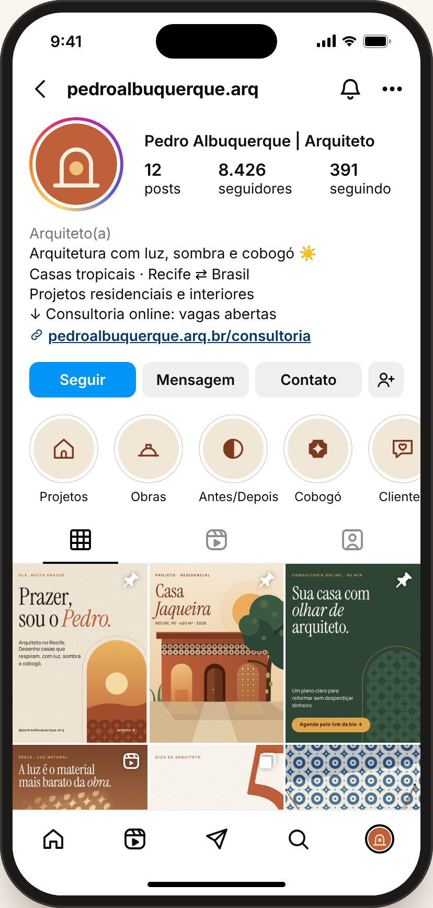
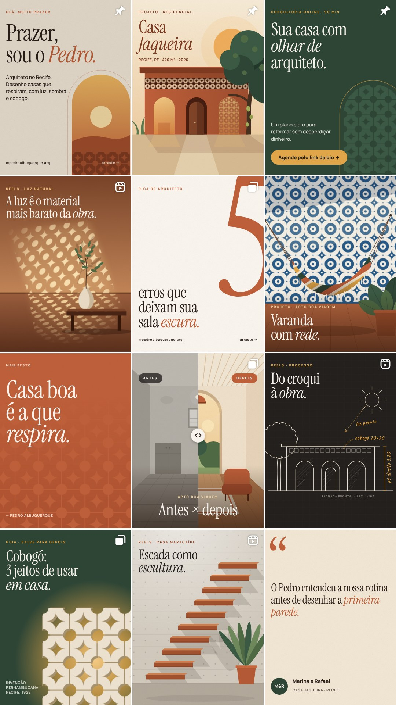

# Instagram · Pedro Albuquerque, arquiteto

Estudo completo de perfil para **@pedroalbuquerque.arq**: posicionamento, identidade visual, bio, destaques e uma grade de 12 posts prontos para publicar.





Abra `index.html` no navegador para ver o perfil interativo (toque nos posts, arraste os carrosséis, compare o antes e depois) e o estudo de marca ao lado.

## Conceito

**Arquitetura com luz, sombra e cobogó.** A identidade nasce do cobogó, o bloco vazado inventado no Recife em 1929, e da luz do Nordeste. O símbolo do Pedro é um arco com o sol dentro.

| Cor | Hex | Uso |
|---|---|---|
| Cal | `#FBF7F0` | fundos e respiro |
| Areia | `#F1E7D7` | base dos posts |
| Terracota | `#C0603A` | cor-assinatura |
| Barro | `#7E3A20` | títulos sobre claro |
| Sol | `#E4A84A` | destaques e botões |
| Mata | `#2E4636` | fundo de oferta |
| Azulejo | `#285A87` | acento raro |
| Grafite | `#23201D` | croquis e texto |

Fontes (gratuitas no Google Fonts): **Instrument Serif** para títulos, **Manrope** para textos, **Caveat** só nas anotações de croqui.

## Perfil

- **Nome:** Pedro Albuquerque | Arquiteto
- **Usuário:** pedroalbuquerque.arq
- **Categoria:** Arquiteto(a)
- **Link:** pedroalbuquerque.arq.br/consultoria

**Bio** (copie e cole):

```
Arquitetura com luz, sombra e cobogó ☀️
Casas tropicais · Recife ⇄ Brasil
Projetos residenciais e interiores
↓ Consultoria online: vagas abertas
```

**Destaques**, nesta ordem:

- **Projetos**: Um destaque por casa: antes, obra e entrega.
- **Obras**: Bastidores semanais de canteiro: mostram método e geram confiança.
- **Antes/Depois**: A prova mais rápida de resultado.
- **Cobogó**: Conteúdo-assinatura: história, modelos e onde usar.
- **Clientes**: Depoimentos em vídeo e mensagens, sempre com autorização.
- **Consultoria**: Como funciona, investimento e link. É o destaque que vende.

## Ordem de publicação

A grade se lê de cima para baixo, mas se publica de baixo para cima. Publique na ordem abaixo e fixe os três últimos no topo do perfil. Ritmo sugerido: 3 posts por semana e stories diários de obra.

| # | Post na grade | Formato | Pilar | Arquivos |
|---|---|---|---|---|
| 1 | 12 · Depoimento | Post único | Conversão | [1](posts/12-depoimento-1.jpg) |
| 2 | 11 · Reel · escada | Reel | Projetos | [grade 4:5](posts/11-escada-1.jpg) [capa 9:16](posts/11-escada-capa-reel.jpg) |
| 3 | 10 · Guia cobogó | Carrossel (6) | Educativo | [1](posts/10-cobogo-1.jpg) [2](posts/10-cobogo-2.jpg) [3](posts/10-cobogo-3.jpg) [4](posts/10-cobogo-4.jpg) [5](posts/10-cobogo-5.jpg) [6](posts/10-cobogo-6.jpg) |
| 4 | 09 · Reel · croqui | Reel | Bastidores | [grade 4:5](posts/09-croqui-1.jpg) [capa 9:16](posts/09-croqui-capa-reel.jpg) |
| 5 | 08 · Antes × depois | Carrossel (4) | Projetos | [1](posts/08-antes-1.jpg) [2](posts/08-antes-2.jpg) [3](posts/08-antes-3.jpg) [4](posts/08-antes-4.jpg) |
| 6 | 07 · Manifesto | Post único | Conexão | [1](posts/07-respira-1.jpg) |
| 7 | 06 · Varanda | Post único | Projetos | [1](posts/06-varanda-1.jpg) |
| 8 | 05 · 5 erros | Carrossel (7) | Educativo | [1](posts/05-erros-1.jpg) [2](posts/05-erros-2.jpg) [3](posts/05-erros-3.jpg) [4](posts/05-erros-4.jpg) [5](posts/05-erros-5.jpg) [6](posts/05-erros-6.jpg) [7](posts/05-erros-7.jpg) |
| 9 | 04 · Reel · luz | Reel | Educativo | [grade 4:5](posts/04-luz-1.jpg) [capa 9:16](posts/04-luz-capa-reel.jpg) |
| 10 | 03 · Consultoria 📌 | Carrossel (4) | Conversão | [1](posts/03-consultoria-1.jpg) [2](posts/03-consultoria-2.jpg) [3](posts/03-consultoria-3.jpg) [4](posts/03-consultoria-4.jpg) |
| 11 | 02 · Casa Jaqueira 📌 | Carrossel (4) | Projetos | [1](posts/02-jaqueira-1.jpg) [2](posts/02-jaqueira-2.jpg) [3](posts/02-jaqueira-3.jpg) [4](posts/02-jaqueira-4.jpg) |
| 12 | 01 · Apresentação 📌 | Carrossel (3) | Conexão | [1](posts/01-prazer-1.jpg) [2](posts/01-prazer-2.jpg) [3](posts/01-prazer-3.jpg) |

📌 = fixar no perfil depois de publicar.

## Legendas

### 01 · Apresentação

Carrossel (3) · arquivos em `posts/01-prazer-*.jpg`

```
Prazer, eu sou o Pedro. 👋
Sou arquiteto no Recife e há 12 anos desenho casas que respiram: muita luz natural, sombra boa, ventilação cruzada e materiais que envelhecem bonito.
Por aqui eu mostro projetos, bastidores de obra e dicas para quem quer reformar sem errar.
Me conta nos comentários: você está construindo, reformando ou só sonhando? ☀️
#arquiteturarecife #arquiteturatropical #cobogó
```

Texto alternativo: Carrossel de apresentação: Prazer, sou o Pedro.

### 02 · Casa Jaqueira

Carrossel (4) · arquivos em `posts/02-jaqueira-*.jpg`

```
Casa Jaqueira — Recife, PE.
A jaqueira já estava lá antes de qualquer desenho. Então o projeto começou por ela: a casa se abre em três arcos para o jardim, e a banda de cobogó filtra o sol da tarde sem fechar a ventilação.
📐 420 m² · 4 suítes · 2026
Arraste para ver a sala e o primeiro croqui. →
#casajaqueira #arquiteturacontemporanea #arquiteturatropical #recife
```

Texto alternativo: Carrossel do projeto Casa Jaqueira: fachada com três arcos e uma jaqueira.

### 03 · Consultoria

Carrossel (4) · arquivos em `posts/03-consultoria-*.jpg`

```
Você não precisa de um projeto completo para reformar com olhar de arquiteto.
Na consultoria online, em 90 minutos a gente olha sua planta, suas fotos e sua rotina. Você sai com um plano claro: o que mudar, em que ordem e onde não gastar.
📩 Vagas de novembro abertas pelo link da bio.
#consultoriadearquitetura #reforma #arquiteturaonline
```

Texto alternativo: Carrossel da consultoria online de 90 minutos.

### 04 · Reel · luz

Reel · arquivos em `posts/04-luz-*.jpg`. O Reel é um vídeo: grave a cena ou anime a arte e use `capa-reel` (9:16) como capa; o arquivo 4:5 é o recorte que aparece na grade.

```
A luz é o material mais barato da obra, e o que mais muda uma casa. ☀️
Esse cobogó desenha um padrão diferente na parede a cada hora do dia. Nenhuma luminária faz isso.
Salva para lembrar na hora de pensar a fachada.
#luznatural #cobogó #arquiteturabioclimatica
```

Texto alternativo: Reel: luz do sol atravessa um cobogó e desenha estrelas na parede.

### 05 · 5 erros

Carrossel (7) · arquivos em `posts/05-erros-*.jpg`

```
Sala escura quase nunca é falta de janela. Quase sempre é um desses 5 erros. 👇
Qual deles acontece aí na sua casa? Me conta que eu respondo com uma solução.
#dicasdearquitetura #iluminacao #decoracao #reforma
```

Texto alternativo: Carrossel: 5 erros que deixam sua sala escura.

### 06 · Varanda

Post único · arquivos em `posts/06-varanda-*.jpg`

```
Rede, azulejo e vento. Precisa de mais alguma coisa? 🌿
Na varanda do Apto Boa Viagem, o azulejo azul e branco conversa com a tradição pernambucana, e os ganchos da rede foram previstos no projeto estrutural, um detalhe que muita gente esquece.
#varanda #azulejo #boaviagem #arquiteturarecife
```

Texto alternativo: Varanda com parede de azulejo azul e branco e uma rede listrada.

### 07 · Manifesto

Post único · arquivos em `posts/07-respira-*.jpg`

```
Casa boa é a que respira.
Antes de pensar em ar-condicionado, eu penso em vento cruzado, sombra e pé-direito. O conforto começa no desenho.
#arquiteturabioclimatica #arquiteturatropical
```

Texto alternativo: Citação: Casa boa é a que respira.

### 08 · Antes × depois

Carrossel (4) · arquivos em `posts/08-antes-*.jpg`

```
Antes × depois — Apto Boa Viagem.
Tiramos uma parede, abrimos um arco para o jardim e trocamos a luz fria por luz quente e indireta. A planta mudou pouco; a sensação mudou tudo.
Arraste para ver o antes e o depois inteiros. →
#antesedepois #reforma #arquiteturadeinteriores
```

Texto alternativo: Antes e depois de uma sala: de cinza e fechada para clara, com arco aberto para o jardim.

### 09 · Reel · croqui

Reel · arquivos em `posts/09-croqui-*.jpg`. O Reel é um vídeo: grave a cena ou anime a arte e use `capa-reel` (9:16) como capa; o arquivo 4:5 é o recorte que aparece na grade.

```
Do croqui à obra. ✏️
Todo projeto meu começa assim: papel, caneta e o caminho do sol no terreno. Só depois vai para o computador.
#processocriativo #croqui #arquitetura
```

Texto alternativo: Reel: croqui da fachada da Casa Jaqueira desenhado à mão.

### 10 · Guia cobogó

Carrossel (6) · arquivos em `posts/10-cobogo-*.jpg`

```
Você sabia que o cobogó nasceu aqui no Recife, em 1929? 🧱
O nome vem das iniciais dos três criadores: Coimbra, Boeckmann e Góis. Quase 100 anos depois, ele continua sendo uma das soluções mais inteligentes para luz e ventilação.
Arraste para ver 3 jeitos de usar na sua casa. →
#cobogó #arquiteturapernambucana #designbrasileiro
```

Texto alternativo: Carrossel-guia: cobogó, 3 jeitos de usar em casa.

### 11 · Reel · escada

Reel · arquivos em `posts/11-escada-*.jpg`. O Reel é um vídeo: grave a cena ou anime a arte e use `capa-reel` (9:16) como capa; o arquivo 4:5 é o recorte que aparece na grade.

```
Escada também pode ser escultura.
Na Casa Maracaípe, os degraus saem direto da parede de concreto, e a luz do zenital desenha a sombra de cada um ao longo do dia.
#escada #concretoaparente #arquiteturacontemporanea
```

Texto alternativo: Reel: escada de degraus soltos presos a uma parede de concreto.

### 12 · Depoimento

Post único · arquivos em `posts/12-depoimento-*.jpg`

```
Nada me deixa mais feliz do que isso. 🤍
Obrigado, Marina e Rafael, por confiarem a Casa Jaqueira a mim. Ver vocês morando nela é a melhor parte do trabalho.
#depoimento #casajaqueira
```

Texto alternativo: Depoimento de clientes: o Pedro entendeu a nossa rotina antes de desenhar a primeira parede.

## Antes de publicar

Número de seguidores, curtidas, o depoimento de “Marina e Rafael”, os projetos e o domínio do link são fictícios, só para apresentação. Troque pelos dados reais do Pedro e confirme cada projeto com ele. Se houver um ensaio fotográfico, use um retrato do Pedro como foto de perfil e deixe o símbolo do arco para destaques e posts.

## Como regenerar as imagens

As artes são HTML e SVG dentro de `index.html`. Abrindo `index.html?export`, a função `renderSlide(post, lâmina, reel)` desenha cada arte em 1080 px de largura para captura (por exemplo, com Playwright).
